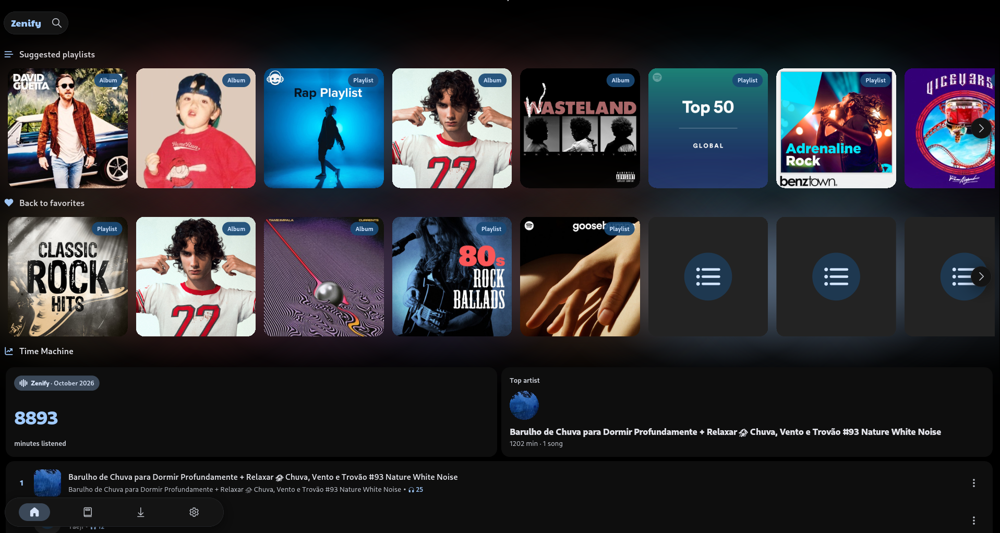
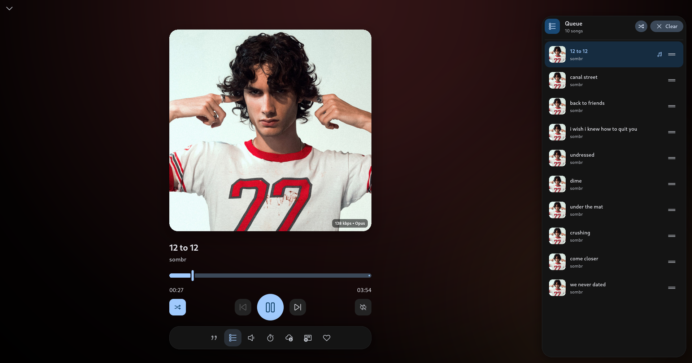
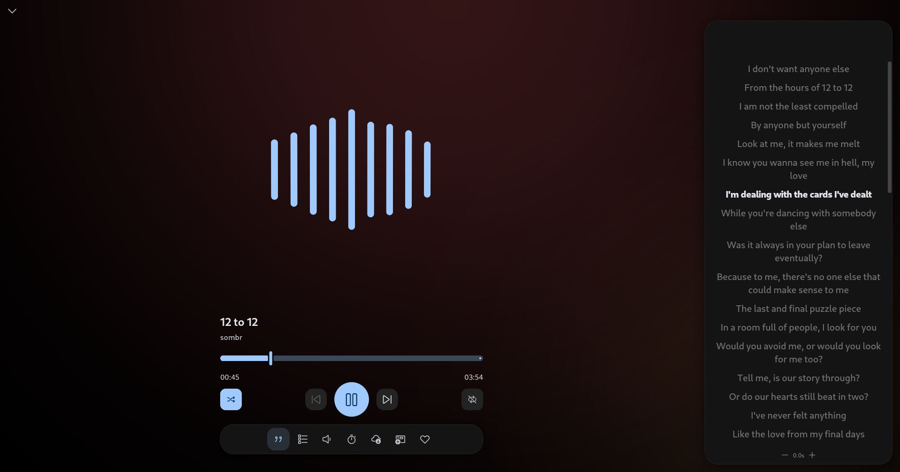
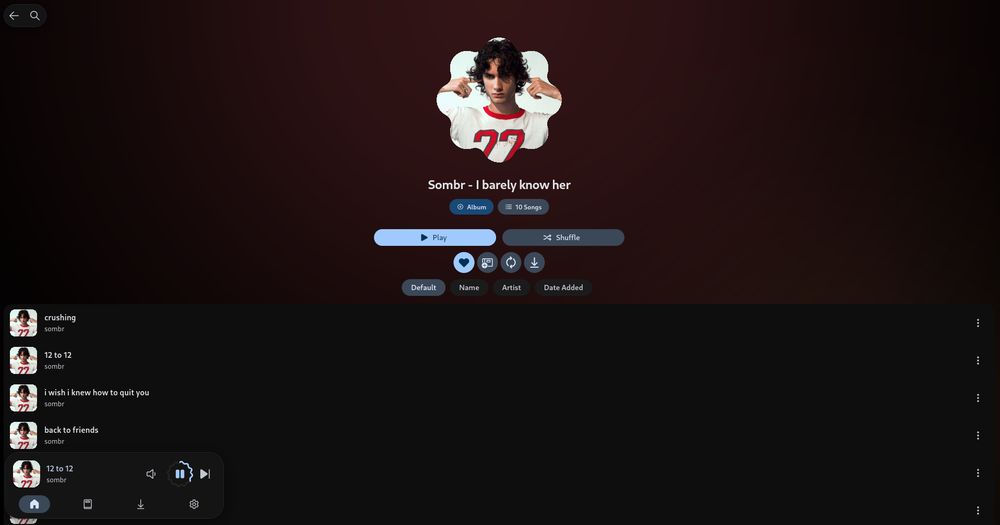
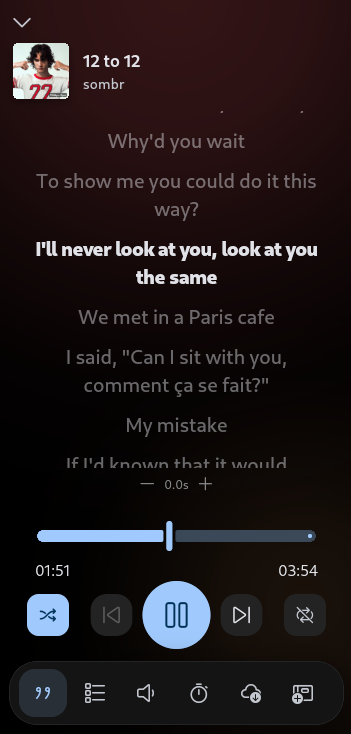
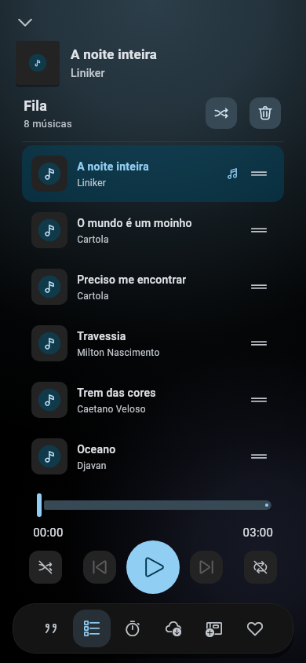
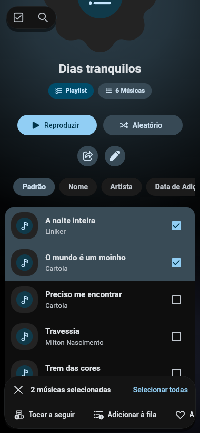

<div align="center">


# Zenify

A calm, modern music app: the community edition of
Musify, with first-class desktop support,
a redesigned interface and syncing between your devices.

[](https://github.com/elias001011/Zenify/releases)
[](LICENSE)
[](https://github.com/elias001011/Musify-Desktop-Port)

</div>

---

## A community edition of Musify

Zenify is a modified version of Musify by Valeri Gokadze, maintained by the
community since October 2026. It keeps Musify's code, features and license,
and goes further where Musify stops: the desktop, the look of the app and
moving your library between devices.

### How it differs from Musify

| | Musify | Zenify |
|---|---|---|
| Platforms | Android, desktop builds | Android, Linux and Windows, with `.deb`, installer and portable builds |
| Interface | Material app bars and bottom navigation | Floating island, dock and desktop rail; solid, translucent or blurred |
| Background | Plain | Optional dynamic background in your albums' colours |
| Player | Flip card with lyrics | Integrated lyrics and queue panels, sound waves and a floating action bar |
| Playlists | Single-song actions | Multi-selection in tap order, batch actions, moving songs and drag-to-reorder for custom playlists |
| Resume | Recently played songs | Saved queue, shuffle order and playback position, restored while paused |
| Library | Sections | Filters (custom, YouTube, albums, artists, offline) and its own search, songs included; global search lists what you own first |
| Listening recap | Minutes and top songs | Cards with minutes, top artists and top songs, shareable per month |
| Downloads | In the background | Download manager with progress, failures and retry |
| Devices | Backup and restore | Local Sync between Android, Linux and Windows over Wi-Fi, plus backup |
| Desktop | Basic | Interface scale, title bar, remappable shortcuts, downloads folder, volume |
| Updates | Musify's releases | Zenify's releases, with the right file for each platform |

Zenify installs next to Musify and keeps its own data. On desktop, the first
run copies an existing Musify library (Musify's own files are never changed);
elsewhere, use the backup in Settings to bring it over.

---

## Features

Everything from Musify:

- Online song search with suggestions
- Offline listening support
- Import & export your data and never lose it
- Custom playlists from a link, and Spotify playlist import
- Listening recaps
- Radio stations
- Synced lyrics
- SponsorBlock support
- Built-in equalizer with presets
- No ads, no subscriptions
- Material UI, accent colors and dynamic colors (Android 12+)
- 21 languages

New in Zenify:

- **A new look**: floating navigation and player, a floating title island with
  quick search, a neutral theme with pure black, and an optional dynamic
  background that glows with the colours of your albums.
- **A new player**: the artwork with the song and playback under it. Lyrics
  and queue open beside it on desktop; on phones they share the artwork's
  space through the same animated transition. Tapping the artwork switches
  to sound waves. They follow the music when audio levels are available and
  keep a gentle motion when capture is unavailable. While audio loads or
  capture recovers, the current Zenify logo appears. Android keeps the
  screen awake while lyrics are open.
- **Multi-selection**: long-press a song to select several tracks in the order
  you tap them. Play next, add to the queue or another playlist, like, download
  or remove a batch. Custom playlists also support moving songs to another
  playlist. Enable the reorder button in a custom playlist to reveal drag
  handles; they start hidden and use the default, unfiltered order.
  On desktop, arrows and the mouse wheel scroll the batch actions.
- **Pick up where you stopped**: the queue and playback position survive app
  restarts. The app opens paused and loads audio when you press play. This
  stays on the device; queues over 1,000 songs retain a window around the
  current track.
- **Search by YouTube link**: paste a watch, share, Shorts, live or embed link
  to find that exact video, alongside the regular text search.
- **Library search and filters**: the library searches its own playlists,
  artists and songs, and the global search lists what you already have
  first. Both keep working offline.
- **Top artists** in the listening recap, worked out from what you play.
- **Download manager**: follow downloads in progress, see what failed and why,
  and retry.
- **Local Sync**: pair Android, Linux and Windows devices with a PIN and keep
  your liked songs, playlists, history, listening recap, searches and radio
  stations in sync over Wi-Fi. No account or server, encrypted, off by default.
- **Desktop settings**: interface scale that zooms the whole app, start
  maximized, a title bar in the app colors and a compact player layout.
- **Keyboard shortcuts** for playback and navigation, all of them remappable.
- **Downloads folder** of your choice on desktop.
- **Built-in updater** for Android, Linux and Windows.

New features are translated into English and Portuguese for now.

---

## Screenshots

### Desktop

Home, album colours and the listening recap on a wide screen:



| Player and queue | Sound waves and synced lyrics |
|---|---|
|  |  |



### Compact and mobile layouts

<table>
  <tr>
    <th>Compact lyrics</th>
    <th>Integrated mobile queue</th>
    <th>Song selection</th>
  </tr>
  <tr>
    <td></td>
    <td></td>
    <td></td>
  </tr>
</table>

Desktop and compact captures come from the local Linux app. The mobile queue
and selection previews are rendered from the current Flutter interface at
390 × 844 with sample data.

---

## Download

Get the files for your platform from the
[latest release](https://github.com/elias001011/Zenify/releases/latest).

| Platform | File | Notes |
|---|---|---|
| Android | `Zenify-arm64-v8a.apk` | Most phones. `Zenify.apk` works on every device. |
| Linux (Debian, Ubuntu) | `Zenify-linux-x64.deb` | Installs `libmpv` for you. |
| Linux (other) | `Zenify-linux-x64.tar.gz` | Needs `libmpv`; run `install-linux-desktop.sh` to add it to your menu. |
| Windows | `Zenify-windows-x64-setup.exe` | Lets you choose where data and downloads go. |
| Windows (portable) | `Zenify-windows-x64-portable.zip` | No installation. |

Every release includes `SHA256SUMS.txt` to verify the files. iOS is not
supported.

---

## Roadmap

- Translations through Crowdin
- More of the interface following the dynamic background

---

## Contribute

Contributions are welcome. Please read the
[contributing guidelines](CONTRIBUTING.md) first.

---

## Credits

- Musify by **Valeri Gokadze** and its contributors: the original codebase,
  preserved under its original copyright notices and GPL license.
- [Musify Desktop Port](https://github.com/elias001011/Musify-Desktop-Port):
  where the desktop features, Local Sync and packaging of this fork were first
  built and tested.
- [Musify](https://github.com/Harsh-23/Musify) by Harsh-23: the original
  inspiration for the concept and name of Musify.

Zenify is developed and maintained by
[Elias Juriatti](https://github.com/elias001011).

---

## License

```
Copyright © 2026 Valeri Gokadze
Copyright © 2026 Elias Juriatti and Zenify contributors
```

Zenify is free software under the
[GNU General Public License v3.0](LICENSE), the same license as Musify. It is
a modified version of Musify: the changes are listed above and in the commit
history, and every file keeps its original copyright notice. You may use,
modify and share it, as long as you keep it under the same license, keep the
notices and make the source code of what you distribute available.

---

## Disclaimer

```
Zenify and its contributors do not host, own, or distribute any copyrighted
audio content. The app provides access to content through plugins and external
sources. All trademarks, songs, audio files, and related content remain the
property of their respective owners and are protected by applicable copyright laws.
Included plugins are provided for interoperability and educational purposes only.
Users are solely responsible for ensuring that their use of the app complies with
local laws, copyright regulations, and the terms of service of the respective
content providers. The developers of Zenify do not encourage or endorse
copyright infringement and assume no liability for misuse of the software or
third-party plugins.
```
