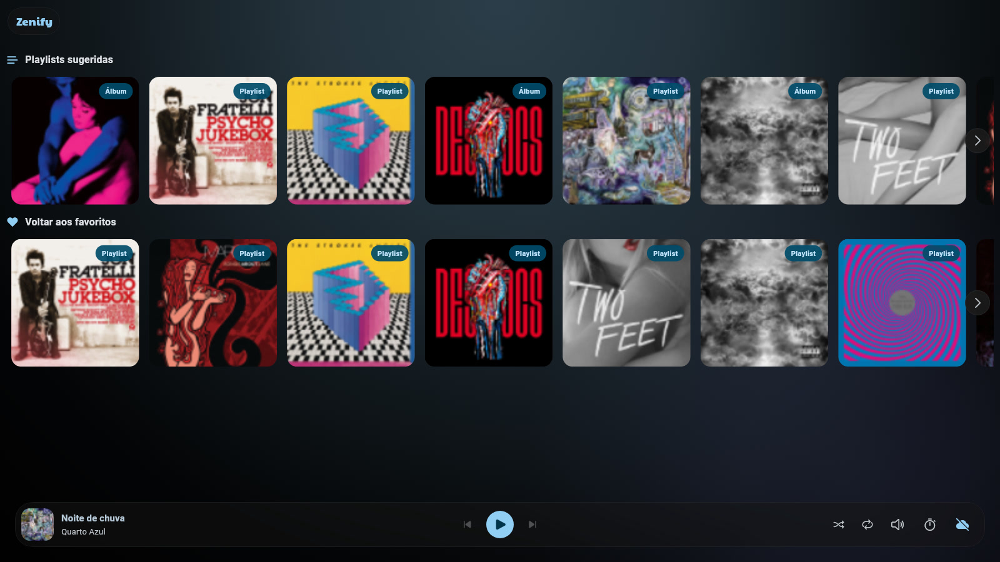
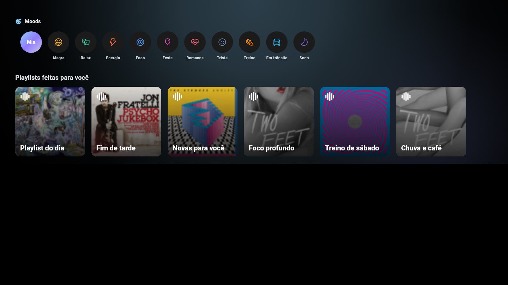
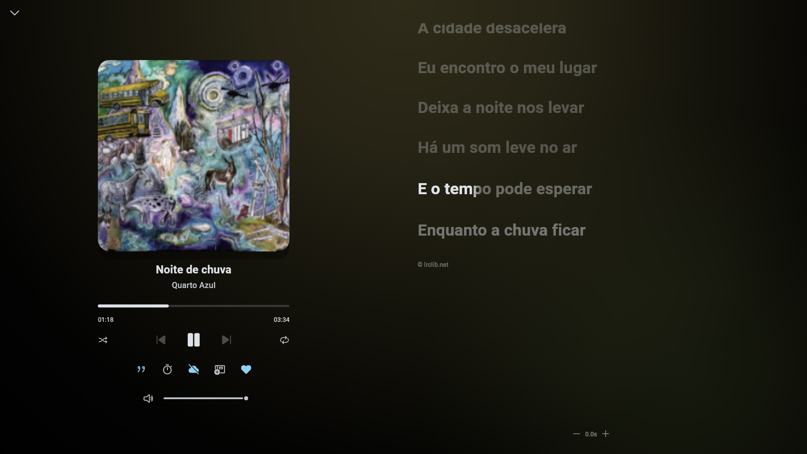
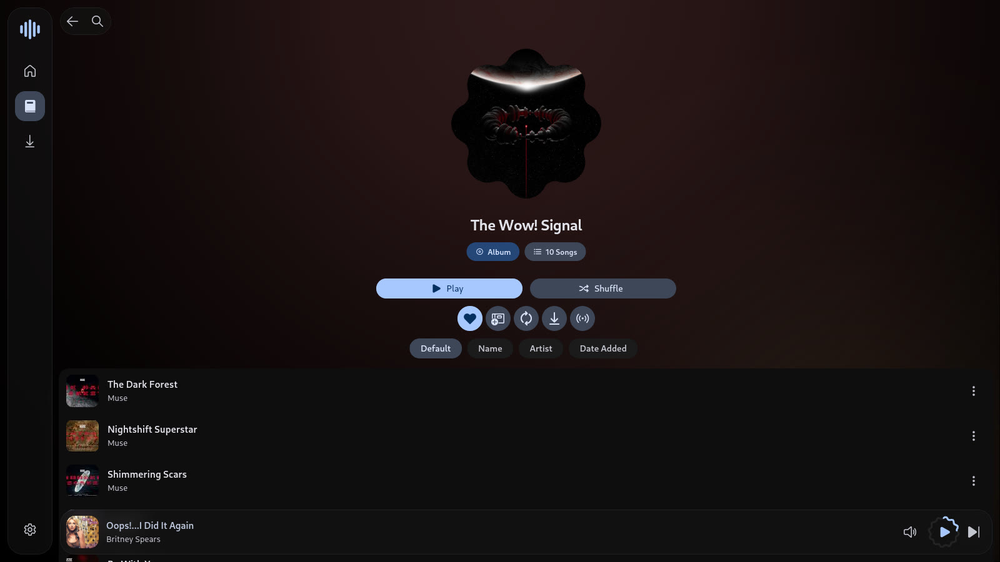
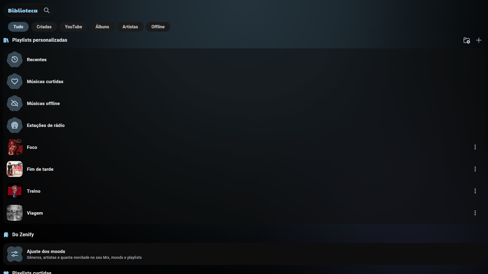
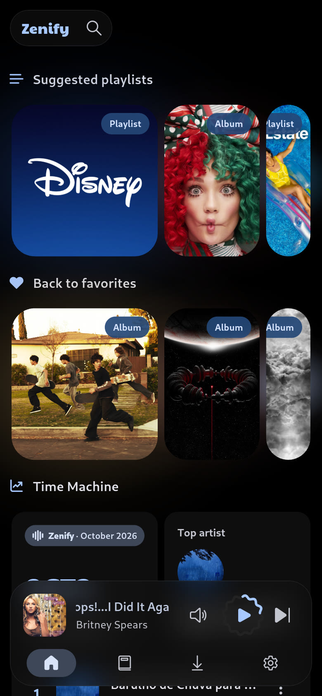
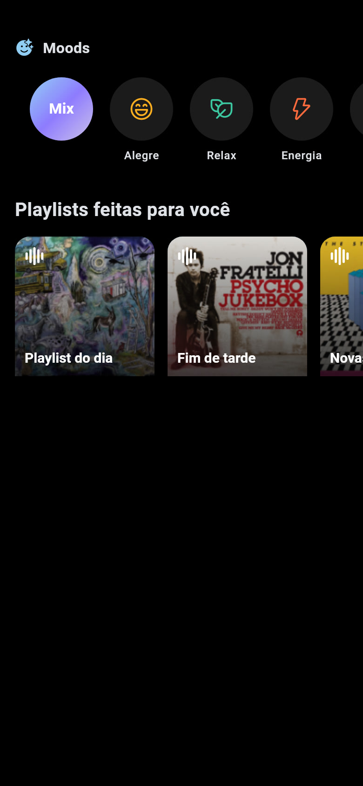
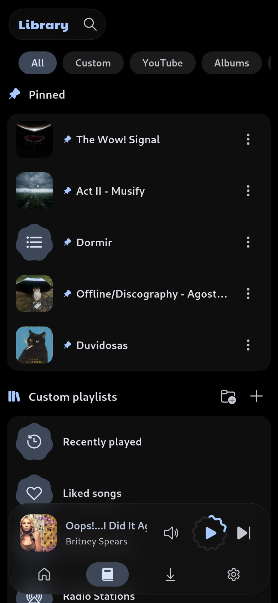
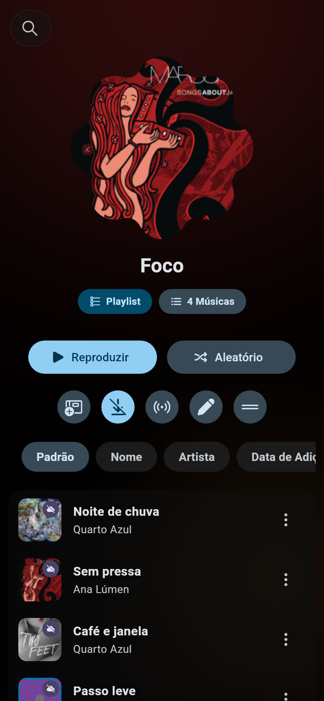
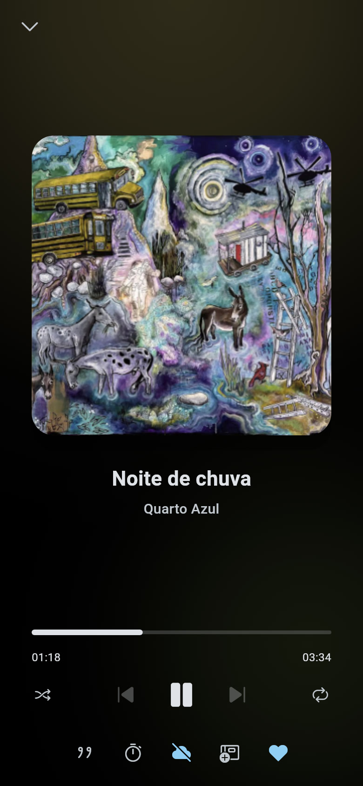

<div align="center">


# Zenify

A calm, modern music app: the community edition of
Musify, with first-class desktop support,
a redesigned interface and syncing between your devices.

[](https://github.com/elias001011/Zenify/releases/latest)

[](https://github.com/elias001011/Zenify/releases/latest)
[](https://github.com/elias001011/Zenify/releases)
[](LICENSE)
[](https://github.com/elias001011/Musify-Desktop-Port)

**Android** · **Linux** · **Windows**

</div>

---

## Download

| Platform | File | Notes |
|---|---|---|
| Android | [`Zenify-arm64-v8a.apk`](https://github.com/elias001011/Zenify/releases/latest/download/Zenify-arm64-v8a.apk) | Most phones. [`Zenify.apk`](https://github.com/elias001011/Zenify/releases/latest/download/Zenify.apk) works on every device. |
| Linux (Debian, Ubuntu) | [`Zenify-linux-x64.deb`](https://github.com/elias001011/Zenify/releases/latest/download/Zenify-linux-x64.deb) | Installs `libmpv` for you. |
| Linux (other) | [`Zenify-linux-x64.tar.gz`](https://github.com/elias001011/Zenify/releases/latest/download/Zenify-linux-x64.tar.gz) | Needs `libmpv`; run `install-linux-desktop.sh` to add it to your menu. |
| Windows | [`Zenify-windows-x64-setup.exe`](https://github.com/elias001011/Zenify/releases/latest/download/Zenify-windows-x64-setup.exe) | Lets you choose where data and downloads go. |
| Windows (portable) | [`Zenify-windows-x64-portable.zip`](https://github.com/elias001011/Zenify/releases/latest/download/Zenify-windows-x64-portable.zip) | No installation. |

Every release includes `SHA256SUMS.txt` to verify the files. iOS is not
supported. All releases, with their notes, are on the
[releases page](https://github.com/elias001011/Zenify/releases).

Releases marked as pre-release are for trying new things: the app's updater
never offers them, so install them by hand.

---

## Screenshots

Taken from the app itself, running on Linux, with a real library.



Moods, a personal Mix and playlists made for you, on Home:



| Player with synced lyrics | Playlist |
|---|---|
|  |  |



### On a phone

The same app at a phone's size (390 × 844).

<table>
  <tr>
    <th>Home</th>
    <th>Moods</th>
    <th>Library</th>
    <th>Playlist</th>
    <th>Player</th>
  </tr>
  <tr>
    <td></td>
    <td></td>
    <td></td>
    <td></td>
    <td></td>
  </tr>
</table>

---

## A community edition of Musify

Zenify is a modified version of Musify by Valeri Gokadze, maintained by the
community since October 2026. It keeps Musify's code, features and license,
and goes further where Musify stops: the desktop, the look of the app and
moving your library between devices.

### How it differs from Musify

| | Musify | Zenify |
|---|---|---|
| Platforms | Android, desktop builds | Android, Linux and Windows, with `.deb`, installer and portable builds |
| Interface | Material app bars and bottom navigation | Floating island, dock and desktop rail; solid, translucent or blurred |
| Background | Plain | Optional dynamic background in your albums' colours |
| Player | Flip card with lyrics | Integrated lyrics and queue panels, sound waves and a floating action bar |
| Discovery | Recommendations and automatic song picker | Optional Moods, personal Mix and Zenify playlists, with taste tuning |
| Playlists | Single-song actions | Multi-selection in tap order, batch actions, moving songs and drag-to-reorder for custom playlists |
| Resume | Recently played songs | Saved queue, shuffle order and playback position, restored while paused |
| Library | Sections | Filters (custom, YouTube, albums, artists, offline) and its own search, songs included; global search lists what you own first |
| Listening recap | Minutes and top songs | Cards with minutes, top artists and top songs, shareable per month |
| Downloads | In the background | Download manager with progress, failures and retry |
| Devices | Backup and restore | Local Sync between Android, Linux and Windows over Wi-Fi, plus backup |
| Desktop | Basic | Interface scale, title bar, remappable shortcuts, downloads folder, volume |
| Updates | Musify's releases | Zenify's releases, with the right file for each platform |

Zenify installs next to Musify and keeps its own data. On desktop, the first
run copies an existing Musify library (Musify's own files are never changed);
elsewhere, use the backup in Settings to bring it over.

---

## Features

Everything from Musify:

- Online song search with suggestions
- Offline listening support
- Import & export your data and never lose it
- Custom playlists from a link, and Spotify playlist import (the songs it could not find can be matched by hand)
- Listening recaps
- Radio stations
- Synced lyrics
- SponsorBlock support
- Built-in equalizer with presets
- No ads, no subscriptions
- Material UI, accent colors and dynamic colors (Android 12+)
- 21 languages

New in Zenify:

- **A new look**: floating navigation and player, a floating title island with
  quick search, a neutral theme with pure black, and an optional dynamic
  background that glows with the colours of your albums.
- **A new player**: the artwork with the song and playback under it. Lyrics
  and queue open beside it on desktop; on phones they share the artwork's
  space through the same animated transition. Tapping the artwork switches
  to sound waves. They follow the music when audio levels are available and
  keep a gentle motion with the simple reading or when capture is unavailable.
  Choose simple or precise reading from the player; paused or buffering audio
  freezes the waves. Android keeps the
  screen awake while lyrics are open.
- **Moods and personal playlists**: start a Mix or choose a mood, and find
  daily, discovery and genre playlists below Time Machine on Home. Tune
  discovery, exclude genres or block artists in Settings. Moods can be
  switched off. Moods, Zenify playlists and radios are hidden in offline mode,
  including in the library; downloaded songs and playlists stay available.
  Saved Zenify playlists and tuning travel with backups and Local Sync.
- **Artist and playlist radios**: start a radio from an artist or playlist;
  YouTube Music supplies the queue, with the automatic picker as a fallback.
  The automatic picker and the suggestions at the end of a playlist also ask
  the YouTube Music radio first, and fall back to related videos when it has
  nothing (offline, sounds, long mixes). Home's recommendations are unchanged.
- **Multi-selection**: long-press a song to select several tracks in the order
  you tap them. Play next, add to the queue or another playlist, like, download
  or remove a batch. Custom playlists also support moving songs to another
  playlist. Enable the reorder button below a custom playlist’s artwork to reveal drag
  handles; they start hidden and use the default, unfiltered order.
  On desktop, arrows and the mouse wheel scroll the batch actions.
- **Pick up where you stopped**: the queue and playback position survive app
  restarts. The app opens paused and loads audio when you press play. This
  stays on the device; queues over 500 songs retain a window around the
  current track.
- **Search by YouTube link**: paste a watch, share, Shorts, live or embed link
  to find that exact video, alongside the regular text search.
- **Library search and filters**: the library searches its own playlists,
  artists and songs, and the global search lists what you already have
  first. Both keep working offline.
- **Top artists** in the listening recap, worked out from what you play.
- **Download manager**: every download goes through one queue, three at a
  time, and a song is never downloaded twice at once. Follow what waits, what
  is downloading and what failed and why, retry one or all, and get a single
  message at the end with what failed. A download is only cut when no data
  arrives for a minute, so very long videos can finish.
- **Unavailable songs and replacing them**: songs YouTube reports as
  unavailable get their own section in the Downloads tab and a notice in the
  playlists you made. Replace searches for another upload (YouTube Music, then
  YouTube) and opens a screen that shows each song beside its replacement:
  play it, refuse a match, search by hand, then cancel or accept. A Spotify
  import tries YouTube Music, then YouTube; only the songs both missed open a
  similar screen, with a manual search, Copy, Cancel and Finish.
- **Local Sync**: pair Android, Linux and Windows devices with a PIN and keep
  your liked songs, playlists, history, listening recap, searches and radio
  stations in sync over Wi-Fi. No account or server, encrypted, off by default.
  An always-on computer or server on your network can take part too with the
  screenless [sync peer](tools/sync_peer/README.md), so a phone and a computer
  that are never on together keep the same library.
- **Desktop settings**: interface scale that zooms the whole app, start
  maximized, a title bar in the app colors and a compact player layout.
- **Keyboard shortcuts** for playback and navigation, all of them remappable.
- **Downloads folder** of your choice on desktop.
- **Built-in updater** for Android, Linux and Windows. Update checks are on
  by default and can be turned off in Settings.

New features are translated into English and Portuguese for now.

---

## Inside the repository

What is here besides the app itself, and what it is for.

| Path | What it is for |
|---|---|
| `lib/`, `test/` | The app and its tests (`flutter test`). |
| `lib/localization/`, `l10n.yaml` | The strings, one `.arb` file per language; `app_en.arb` is the template. See [translations](CONTRIBUTING.md#translations). |
| `packages/youtube_explode_dart` | The YouTube client the app uses for search, streams and playlists, kept here so fixes do not wait for a release of the package. |
| `packages/youtube_music_explode_dart` | A small YouTube Music client: radios, mixes, artist pages, charts and moods. |
| `packages/just_audio_media_kit` | Plays audio on Linux and Windows (`just_audio` over `media_kit` and libmpv). |
| `packages/receive_sharing_intent` | Lets Android hand a shared YouTube link to the app. |
| [`tools/sync_peer/`](tools/sync_peer/README.md) | The screenless Local Sync peer, for a server that is always on. |
| `tool/generate_icons_test.dart` | Draws the Zenify icon in every size the platforms need: `flutter test tool/generate_icons_test.dart`. |
| `scripts/release_version.sh`, `update.sh` | Read the version from `pubspec.yaml` (`release_version` adds a hotfix number) and write it to `lib/constants/version.dart`. The release workflow and the packaging use them. |
| `scripts/checker.dart`, `scripts/checkdb.sh` | Check that the built-in playlists and albums still exist on YouTube and have artwork; the report goes to `checker.txt`. |
| `announcement.json` | A link the home page shows as an announcement while it is set; the app reads it from this branch. |
| `.github/workflows/release.yml` | Builds the Android, Linux and Windows files and publishes them as a draft release. |
| `.github/workflows/debug.yml`, `validate_windows.yml` | Run by hand: a debug APK, and a full check of the Windows package (tests, startup, icons, installer). |
| `.github/scripts/`, `.github/installer/` | The release's helpers: startup and icon checks, the `.deb` and `.tar.gz` packaging, the Windows installer (Inno Setup). |
| `fastlane/metadata/` | The store texts and icon, for catalogs that read them (F-Droid style). |

---

## Roadmap

- More community translations through [translation files and pull requests](CONTRIBUTING.md#translations)
- More of the interface following the dynamic background

---

## Contribute

Contributions are welcome. Please read the
[contributing guidelines](CONTRIBUTING.md) first.

---

## Credits

- Musify by **Valeri Gokadze** and its contributors: the original codebase,
  preserved under its original copyright notices and GPL license.
- [Musify Desktop Port](https://github.com/elias001011/Musify-Desktop-Port):
  where the desktop features, Local Sync and packaging of this fork were first
  built and tested.
- [youtube_music_explode_dart](https://github.com/elias001011/youtube_music_explode_dart):
  the fork maintained by Elias for Zenify’s YouTube Music integration
  (radios, playlists, charts and moods).
- [Musify](https://github.com/Harsh-23/Musify) by Harsh-23: the original
  inspiration for the concept and name of Musify.

Zenify is developed and maintained by
[Elias Juriatti](https://github.com/elias001011).

---

## License

```
Copyright © 2026 Valeri Gokadze
Copyright © 2026 Elias Juriatti and Zenify contributors
```

Zenify is free software under the
[GNU General Public License v3.0](LICENSE), the same license as Musify. It is
a modified version of Musify: the changes are listed above and in the commit
history, and every file keeps its original copyright notice. You may use,
modify and share it, as long as you keep it under the same license, keep the
notices and make the source code of what you distribute available.

---

## Disclaimer

```
Zenify and its contributors do not host, own, or distribute any copyrighted
audio content. The app provides access to content through plugins and external
sources. All trademarks, songs, audio files, and related content remain the
property of their respective owners and are protected by applicable copyright laws.
Included plugins are provided for interoperability and educational purposes only.
Users are solely responsible for ensuring that their use of the app complies with
local laws, copyright regulations, and the terms of service of the respective
content providers. The developers of Zenify do not encourage or endorse
copyright infringement and assume no liability for misuse of the software or
third-party plugins.
```
