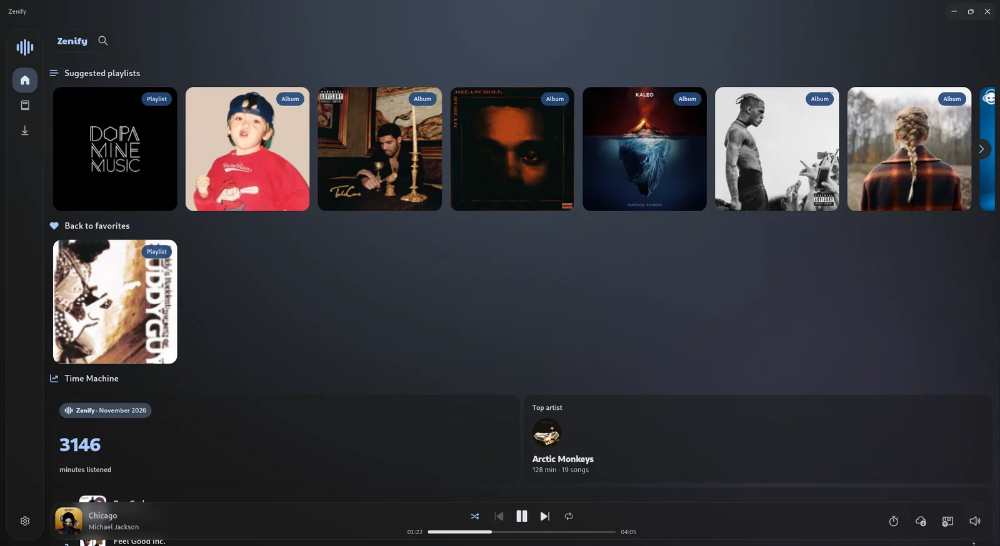
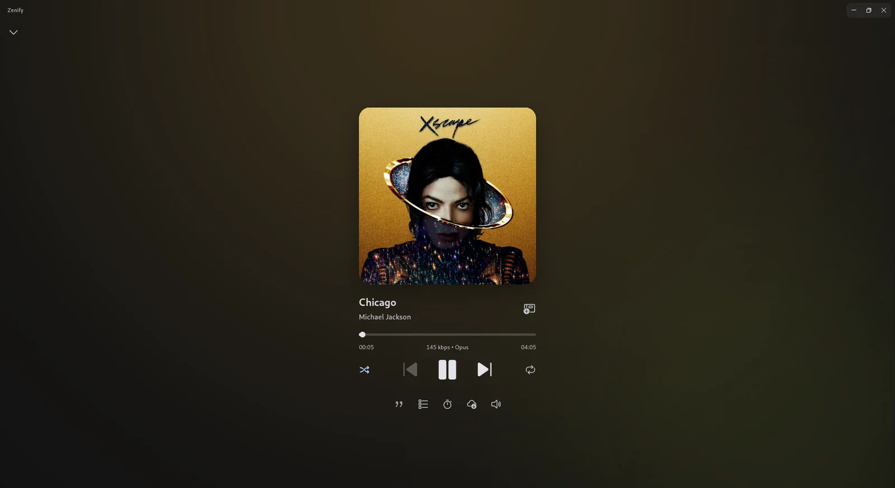
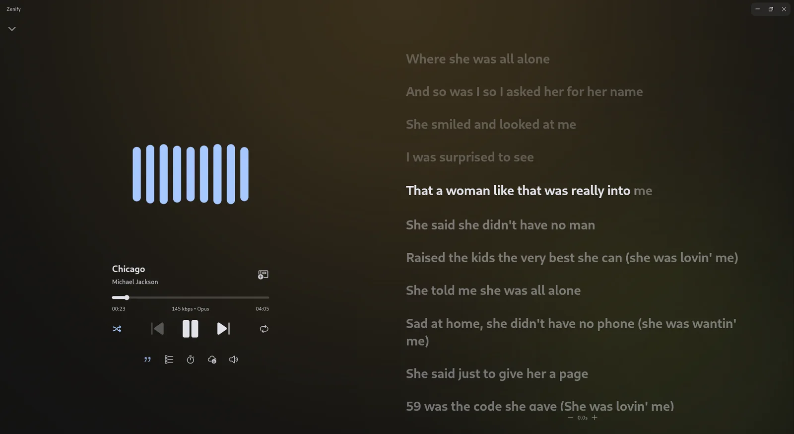
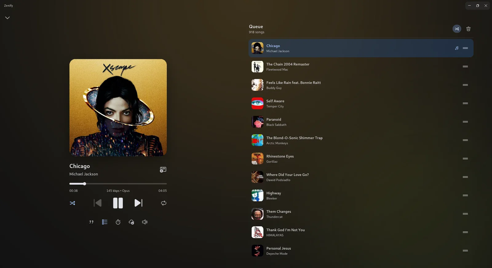
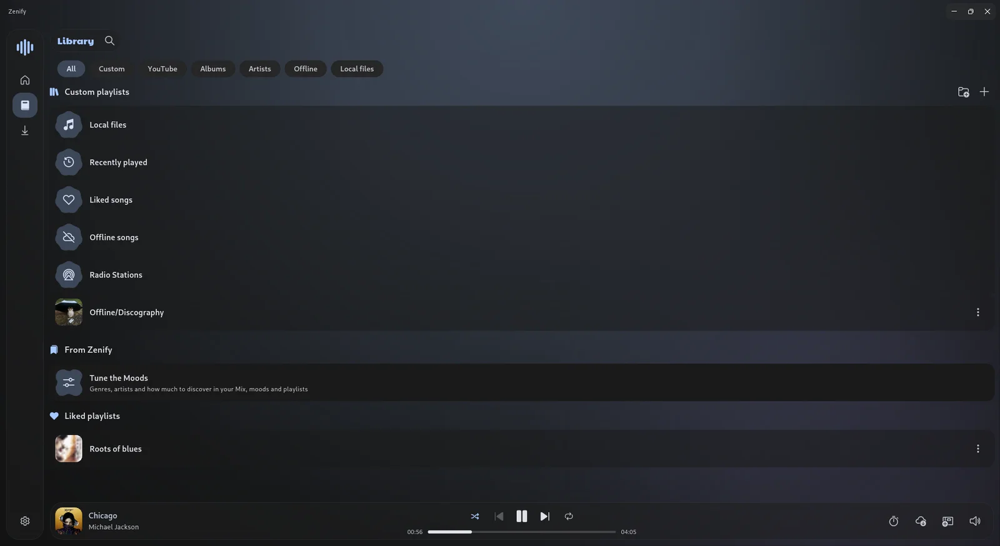
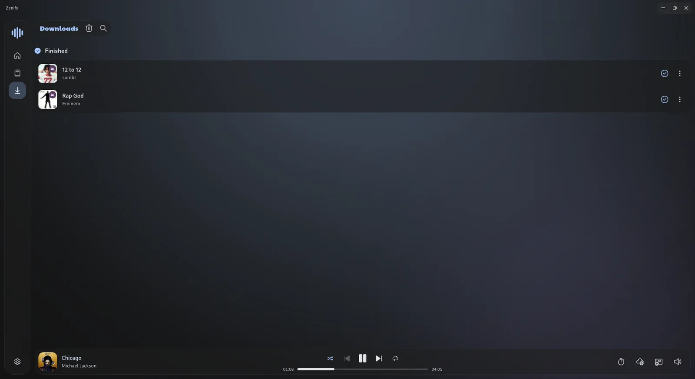
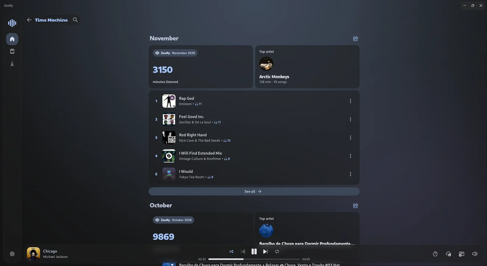
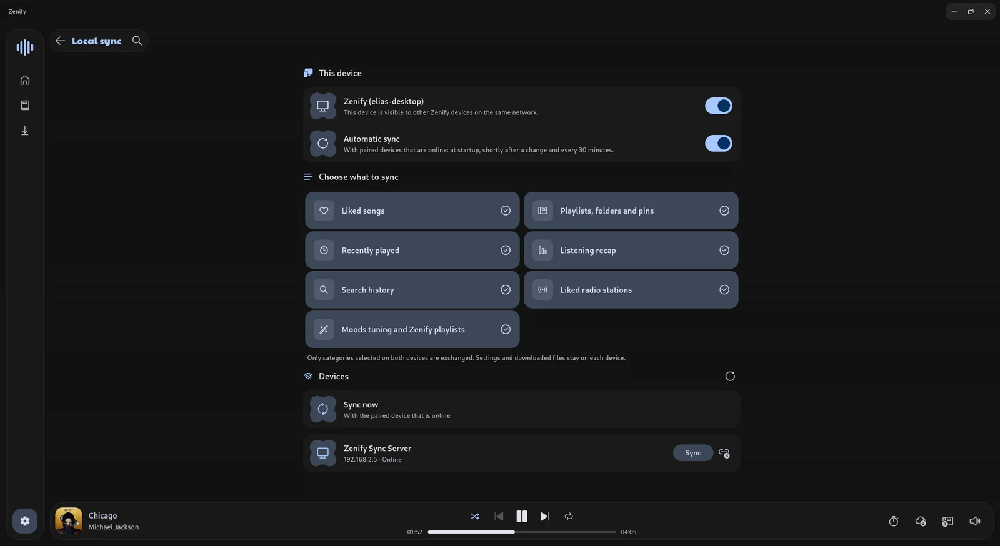
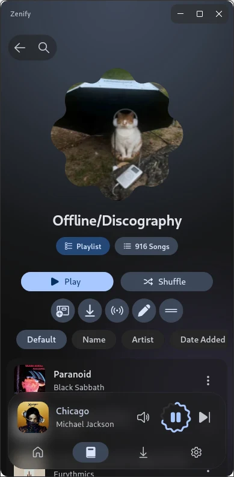
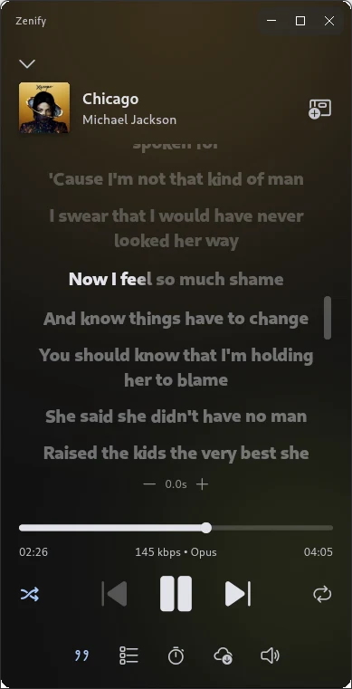

<div align="center">


# Zenify

A calm, modern music app: the community edition of
Musify, with first-class desktop support,
a redesigned interface and syncing between your devices.

[](https://github.com/elias001011/Zenify/releases/latest)

[](https://github.com/elias001011/Zenify/releases/latest)
[](https://github.com/elias001011/Zenify/releases)
[](LICENSE)
[](https://github.com/elias001011/Musify-Desktop-Port)

**Android** · **Linux** · **Windows**

</div>

---

## Download

| Platform | File | Notes |
|---|---|---|
| Android | [`Zenify-arm64-v8a.apk`](https://github.com/elias001011/Zenify/releases/latest/download/Zenify-arm64-v8a.apk) | Most phones. [`Zenify.apk`](https://github.com/elias001011/Zenify/releases/latest/download/Zenify.apk) works on every device. |
| Linux (Debian, Ubuntu) | [`Zenify-linux-x64.deb`](https://github.com/elias001011/Zenify/releases/latest/download/Zenify-linux-x64.deb) | Installs `libmpv` for you. |
| Linux (other) | [`Zenify-linux-x64.tar.gz`](https://github.com/elias001011/Zenify/releases/latest/download/Zenify-linux-x64.tar.gz) | Needs `libmpv`; run `install-linux-desktop.sh` to add it to your menu. |
| Windows | [`Zenify-windows-x64-setup.exe`](https://github.com/elias001011/Zenify/releases/latest/download/Zenify-windows-x64-setup.exe) | Lets you choose where data and downloads go. |
| Windows (portable) | [`Zenify-windows-x64-portable.zip`](https://github.com/elias001011/Zenify/releases/latest/download/Zenify-windows-x64-portable.zip) | No installation. |

Requirements: Android 7.0 (API 24) or newer, Linux x64 and Windows x64.

Every release includes `SHA256SUMS.txt` to verify the files. iOS is not
supported. All releases, with their notes, are on the
[releases page](https://github.com/elias001011/Zenify/releases).

Releases marked as pre-release are for trying new things: the app's updater
never offers them, so install them by hand.

Questions and ideas go to the
[discussions](https://github.com/elias001011/Zenify/discussions); bugs to the
[issues](https://github.com/elias001011/Zenify/issues).

---

## Screenshots

Taken from the app itself, running on Linux (version 0.3.0), with the author's own library. The album covers belong to their artists and only decorate the screenshots.



The player is one design for the phone and the desktop. On a wide window it opens the lyrics or the queue beside the cover, and the sound waves can replace the cover with a tap:

| Player | Synced lyrics and sound waves |
|---|---|
|  |  |



Library, with custom playlists, the Moods tuning and liked playlists:



Downloads, in one queue:



Listening recap (Time Machine), with the minutes, top artist and top songs of each month:



Local Sync: choose what to sync and pair with your other devices on the same network, with no account:



### In a narrow window

The same app in a narrow window, which is the layout the phone uses.

<table>
  <tr>
    <th>Playlist</th>
    <th>Player</th>
    <th>Lyrics</th>
  </tr>
  <tr>
    <td></td>
    <td></td>
    <td></td>
  </tr>
</table>

---

## A community edition of Musify

Zenify is a modified version of Musify by Valeri Gokadze, developed and
maintained by Elias Juriatti since October 2026, with contributions from the
community. It keeps Musify's code, features and license,
and goes further where Musify stops: the desktop, the look of the app and
moving your library between devices.

Local Sync, the device-to-device sync described below, also went upstream:
[pull request #1005](https://github.com/gokadzev/Musify/pull/1005) by
Elias Juriatti was merged into Musify on 7 November 2026.

### How it differs from Musify

| | Musify | Zenify |
|---|---|---|
| Platforms | Android, desktop builds | Android, Linux and Windows, with `.deb`, installer and portable builds |
| Interface | Material app bars and bottom navigation | Floating island, dock and desktop rail; solid, translucent or blurred |
| Background | Plain | Optional dynamic background in your albums' colours |
| Player | Flip card with lyrics | Integrated lyrics and queue panels, sound waves and a floating action bar |
| Discovery | Recommendations and automatic song picker | Optional Moods, personal Mix and Zenify playlists, with taste tuning |
| Playlists | Single-song actions | Multi-selection in tap order, batch actions, moving songs and drag-to-reorder for custom playlists |
| Resume | Recently played songs | Saved queue, shuffle order and playback position, restored while paused |
| Library | Sections | Filters (custom, YouTube, albums, artists, offline) and its own search, songs included; global search lists what you own first |
| Listening recap | Minutes and top songs | Cards with minutes, top artists and top songs, shareable per month |
| Downloads | In the background | Download manager with progress, failures and retry |
| Devices | Backup and restore | Local Sync between Android, Linux and Windows over Wi-Fi, plus backup; the sync identity and downloads stay out of Android's automatic backup |
| Desktop | Basic | Interface scale, title bar, remappable shortcuts, downloads folder, volume |
| Updates | Musify's releases | Zenify's releases, with the right file for each platform |

Zenify installs next to Musify and keeps its own data. On desktop, the first
run copies an existing Musify library (Musify's own files are never changed);
elsewhere, use the backup in Settings to bring it over.

---

## Features

Everything from Musify:

- Online song search with suggestions
- Offline listening support
- Import & export your data and never lose it
- Custom playlists, Spotify playlist import (the songs it could not find can be matched by hand) and, on Android, opening the playlist links Musify shares (Zenify does not create them)
- Listening recaps
- Radio stations
- Synced lyrics
- SponsorBlock support (off by default)
- Built-in equalizer with presets (Android)
- No ads, no subscriptions
- Material UI, accent colors and dynamic colors (Android 12+)
- 21 languages

New in Zenify:

- **A new look**: floating navigation and player, a floating title island with
  quick search, a neutral theme with pure black, and an optional dynamic
  background that follows album colours in the player and playlist, and the app accent elsewhere.
  In translucent mode, the floating surfaces are a little more transparent and
  have a light sheen and rim.
- **A new player**: the artwork with the song and playback under it. Lyrics
  and queue open beside it in wide windows; in narrow windows they share the artwork's
  space through the same animated transition. Tapping the artwork switches
  to sound waves. With the precise reading, chosen in Settings (on Android it
  asks for audio access), they follow the music's frequencies; with the simple
  reading, or when audio levels are unavailable, they keep a gentle motion of
  their own. While nothing plays (paused, buffering, loading) the waves go down
  to a row of dots and rest. Android keeps the screen awake while lyrics are
  open and music plays.
- **Moods and personal playlists**: start a Mix or choose a mood, and find
  daily, discovery and genre playlists below Time Machine on Home. Tune
  discovery, exclude genres or block artists in Settings. Moods can be
  switched off. Moods, Zenify playlists and radios are hidden in offline mode,
  including in the library; downloaded songs and playlists stay available.
  Saved Zenify playlists and tuning travel with backups and Local Sync.
- **Local files** (off by default, on if you already had some): turn on *Show
  local files* in Settings to see the audio kept on your device in the library.
  Each file is copied into the app's own storage, so it keeps playing when the
  picker's cache is cleared. They play like any song, but they are never
  downloaded, liked, added to playlists, synced, backed up or counted in your
  recap, and their lyrics are never looked up.
- **Export playlists as CSV** (online only): Settings, below the Spotify
  import. Pick playlists, albums, saved Zenify playlists or your liked songs;
  each becomes a CSV file with Song and Artist columns that *Import playlist
  from Spotify* reads back. On desktop you choose a folder; on Android the
  files go through the share sheet.
- **Add to playlist from Recents, Liked and Offline songs**: the same button
  the playlist pages have, for every song on the page, hidden in offline mode.
- **Artist, playlist and song radios**: start a radio from an artist, a playlist
  or a song's menu (online songs only, not local files);
  YouTube Music supplies the queue, with the automatic picker as a fallback.
  The automatic picker and the suggestions at the end of a playlist also ask
  the YouTube Music radio first, and fall back to related videos when it has
  nothing (offline, sounds, long mixes). Home's recommendations are unchanged.
- **Multi-selection**: long-press a song to select several tracks in the order
  you tap them. Play next, add to the queue or another playlist, like, download
  or remove a batch. Custom playlists also support moving songs to another
  playlist. Enable the reorder button below a custom playlist’s artwork to reveal drag
  handles; they start hidden and use the default, unfiltered order.
  On desktop, arrows and the mouse wheel scroll the batch actions.
- **Fade between songs** (Settings, off by default, 2 to 12 seconds): a song
  fades out as it ends and the next one fades in when the queue moves on by
  itself. The two songs do not play over each other (that is a crossfade, on
  the roadmap).
- **Load songs far ahead** (Android, Settings, off by default): loads up to 10
  minutes of a song in advance, so a slow connection does not cut it off. It
  uses more mobile data, and takes effect the next time the app opens.
- **Pick up where you stopped**: the queue and playback position survive app
  restarts. The app opens paused and loads audio when you press play. This
  stays on the device; queues over 500 songs retain a window around the
  current track.
- **Search by YouTube link**: paste a watch, share, Shorts, live or embed link
  to find that exact video, alongside the regular text search.
- **Library search and filters**: the library searches its own playlists,
  artists and songs, and the global search lists what you already have
  first. Both keep working offline.
- **Top artists** in the listening recap, worked out from what you play. The
  recap of the current month counts every song on the device; only the top 250
  songs of the month go to backups and Local Sync, in Musify's own format, so a
  Zenify backup still opens in Musify.
- **Download manager**: every download goes through one queue, three at a
  time, and a song is never downloaded twice at once. Follow what waits, what
  is downloading and what failed and why, retry one or all, and get a single
  message at the end with what failed. A download is only cut when no data
  arrives for a minute, so very long videos can finish. A song downloaded from
  its own row shows its progress on its cover; the songs of a playlist download
  are followed in the Downloads tab.
- **Unavailable songs and replacing them**: songs YouTube reports as
  unavailable get their own section in the Downloads tab and a notice in the
  playlists you made. Replace searches for another upload (YouTube Music, then
  YouTube) and opens a screen that shows each song beside its replacement:
  play it, refuse a match, search by hand, then cancel or accept. A Spotify
  import tries YouTube Music, then YouTube; only the songs both missed open a
  similar screen, with a manual search, Copy, Cancel and Finish.
- **Local Sync**: pair Android, Linux and Windows devices with a PIN and keep
  your liked songs, playlists, history, listening recap, searches and radio
  stations in sync over Wi-Fi, and Moods choices between Zenify devices. No
  account or server; the data is encrypted with AES-256-GCM. The feature is off
  by default, and with it off no sync server or discovery runs. With automatic
  sync off, the sync server runs only while the Local Sync page is open. On
  mobile data alone the app does not look for devices; on another Wi-Fi it
  looks, but only devices you paired with a PIN can sync. Only answers from
  your local network count: the search ignores the rest, and the app never
  follows a device's answer to another address.
  An always-on computer or server on your network can take part too with the
  screenless [sync peer](tools/sync_peer/README.md), so a phone and a computer
  that are never on together keep the same library.
- **Desktop volume**: a volume button at the end of the player's action bar
  opens a thin, upright volume slider.
- **Desktop settings**: interface scale that zooms the whole app, start
  maximized, a title bar in the app colors and a compact player layout.
- **Keyboard shortcuts** for playback and navigation, all of them remappable.
- **Reduced motion**: Zenify's own animations (player, lyrics, sound waves,
  mini player, navigation, scrolling titles and the background glow) follow
  the system's *Remove animations*: they change at once or stay still.
- **Downloads folder** of your choice on desktop.
- **Built-in updater** for Android, Linux and Windows. Update checks are on
  by default and can be turned off in Settings.

New features are translated into English and Portuguese for now.

---

## Privacy: what the app contacts

Zenify has no account, no sign-in and no analytics or crash reporting: its code
and dependencies include no tracking or crash-reporting service, and nothing
about your use is sent to the developers. Your library (likes, playlists,
history, settings and listening stats) is kept on your device.

The app contacts only the services below, and only in the cases listed.
**Offline mode** (Settings) turns off every online feature, including the
startup checks.

| Service | When the app contacts it | How to turn it off |
|---|---|---|
| **YouTube and YouTube Music** (`youtube.com`, `music.youtube.com`, `googlevideo.com` for audio, `img.youtube.com` for thumbnails, `suggestqueries.google.com` for search suggestions) | Search, playback, playlists, artists, radios, Moods, recommendations, and related videos when *External recommendations* is on | Offline mode. There is no switch for YouTube alone. |
| **SponsorBlock** (`sponsor.ajay.app`) | For songs played online, with *SponsorBlock* on, to get the video's skip segments. Downloading a song also asks for its segments (the video ID is sent) even while the switch is off; the switch only decides whether they are used. | *SponsorBlock* switch, off by default. |
| **Lyrics** (`lrclib.net`, `api.lyrics.ovh`, `www.paroles.net`, `www.lyricsmania.com`) | When the lyrics panel shows a song, with its artist and title. Not for local files or live radios. | Offline mode. *Synced lyrics* only chooses between timed and plain lines. |
| **Artwork** (`i.scdn.co`, `is1-ssl.mzstatic.com`, and the logo hosts of the built-in radios) | Covers of the built-in albums and playlists, and radio logos, when those pages show them | No switch. |
| **Radio streams** | The stream server of the radio station you play | Do not play a radio, or use Offline mode (radios are hidden there). |
| **Updates** (`api.github.com`, `raw.githubusercontent.com`) | At startup, unless Offline mode is on: the latest release and the `announcement.json` file. *Download app update* checks when you tap it. | *Automatic update checks* (on by default) stops the startup release check. Only Offline mode stops the announcement file. |
| **Public proxies** (`spys.me`, `api.proxyscrape.com`, `proxylist.geonode.com`, and two lists on `raw.githubusercontent.com`) | With *Use proxy* on, these lists are downloaded and streams go through the proxies they list. With it off, Zenify still tries them as a last resort when YouTube refuses a stream for this device; a video that is unplayable for everyone is not retried this way. | *Use proxy* (off by default) stops routine use. No switch turns off the last-resort fallback; Offline mode avoids online streams altogether. |
| **Local Sync** (your own network only) | Only when Local Sync is on: devices on the same Wi-Fi find each other by UDP broadcast and talk over a local HTTP server on a random port, with PIN pairing and AES-256-GCM encryption. With automatic sync off, the server runs only while the Local Sync page is open. On mobile data alone there is no search. Only devices with a local network address are contacted, and nothing goes to the internet. | *Local Sync* in Settings, off by default. With it off, no server or discovery runs. |

Other things the app does:

- **Spotify import** reads a CSV file you pick or paste and searches each song
  on YouTube. It sends nothing to Spotify.
- **Links** such as *Report a bug*, *Translate* and the Spotify playlist
  exporter open in your browser when you tap them.
- **Logs** are kept in memory and copied only when you tap *Copy logs*.
- **Backups** are files you save where you choose. Android's automatic backup
  leaves out the sync identity, downloaded songs, artwork, local files and the
  cache.

Stored only on the device: the library, settings, listening stats, the queue,
downloads, local files and the image cache. What the services listed above do
with the requests they receive: not verified.

---

## Inside the repository

What is here besides the app itself, and what it is for.

| Path | What it is for |
|---|---|
| `lib/`, `test/` | The app and its tests (`flutter test`). |
| `lib/localization/`, `l10n.yaml` | The strings, one `.arb` file per language; `app_en.arb` is the template. See [translations](CONTRIBUTING.md#translations). |
| `packages/youtube_explode_dart` | The YouTube client the app uses for search, streams and playlists, kept here so fixes do not wait for a release of the package. |
| `packages/youtube_music_explode_dart` | A small YouTube Music client: radios, mixes, artist pages, charts and moods. |
| `packages/just_audio_media_kit` | Plays audio on Linux and Windows (`just_audio` over `media_kit` and libmpv). |
| `packages/receive_sharing_intent` | Lets Android hand a shared YouTube link to the app. |
| [`tools/sync_peer/`](tools/sync_peer/README.md) | The screenless Local Sync peer, for a server that is always on. |
| `tool/generate_icons_test.dart` | Draws the Zenify icon in every size the platforms need: `flutter test tool/generate_icons_test.dart`. |
| `scripts/release_version.sh`, `update.sh` | Read the version from `pubspec.yaml` (`release_version` adds a hotfix number) and write it to `lib/constants/version.dart`. The release workflow and the packaging use them. |
| `scripts/checker.dart`, `scripts/checkdb.sh` | Check that the built-in playlists and albums still exist on YouTube and have artwork; the report goes to `checker.txt`. |
| `announcement.json` | A link the home page shows as an announcement while it is set; the app reads it from this branch. |
| `.github/workflows/ci.yml` | Runs the analyzer and the tests on every push to `master` and every pull request; a second job runs the native player tests with libmpv. |
| `.github/workflows/release.yml` | Builds the Android, Linux and Windows files and publishes them as a draft release. |
| `.github/workflows/debug.yml`, `validate_windows.yml` | Run by hand: a debug APK, and a full check of the Windows package (tests, startup, icons, installer). |
| `.github/scripts/`, `.github/installer/` | The release's helpers: startup and icon checks, the `.deb` and `.tar.gz` packaging, the Windows installer (Inno Setup). |
| `fastlane/metadata/` | The store texts and icon, for catalogs that read them (F-Droid style). |

---

## Roadmap

- More community translations through [translation files and pull requests](CONTRIBUTING.md#translations)
- More of the interface following the dynamic background
- Transitions between songs: the next song starting while the last one fades out, with Spotify-style mixes
- Translated lyrics

---

## Contribute

Contributions are welcome. Please read the
[contributing guidelines](CONTRIBUTING.md) first.

---

## Credits

- Musify by **Valeri Gokadze** and its contributors: the original codebase,
  preserved under its original copyright notices and GPL license.
- [Musify Desktop Port](https://github.com/elias001011/Musify-Desktop-Port):
  where the desktop features, Local Sync and packaging of this fork were first
  built and tested.
- [youtube_music_explode_dart](https://github.com/elias001011/youtube_music_explode_dart):
  the fork maintained by Elias for Zenify’s YouTube Music integration
  (radios, playlists, charts and moods).
- [Musify](https://github.com/Harsh-23/Musify) by Harsh-23: the original
  inspiration for the concept and name of Musify.

Zenify is developed and maintained by
[Elias Juriatti](https://github.com/elias001011).

---

## License

```
Copyright © 2026 Valeri Gokadze
Copyright © 2026 Elias Juriatti and Zenify contributors
```

Zenify is free software under the
[GNU General Public License v3.0](LICENSE), the same license as Musify. It is
a modified version of Musify: the changes are listed above and in the commit
history, and every file keeps its original copyright notice. You may use,
modify and share it, as long as you keep it under the same license, keep the
notices and make the source code of what you distribute available.

---

## Disclaimer

```
Zenify does not host, store or distribute copyrighted audio. It has no server
of its own that handles music. Songs are read from YouTube and YouTube Music
and, when you download them, saved on your own device. Zenify is made for
personal use.

Whoever uses the app is responsible for following the copyright law of their
country and the terms of service of YouTube and YouTube Music. Songs, artwork,
trademarks and other content belong to their owners.

To report content that should not be in the project, open an issue at
https://github.com/elias001011/Zenify/issues. The developers do not encourage
or endorse copyright infringement and are not liable for how the software is used.
```
